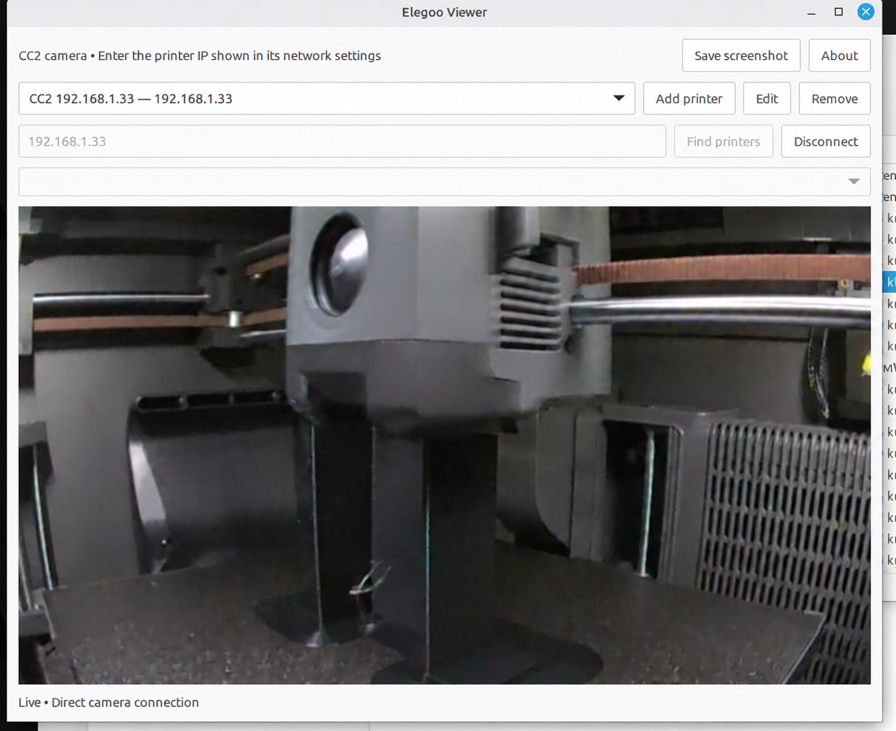

# Elegoo Viewer

Standalone Linux desktop camera viewer for the Elegoo Centauri Carbon 2. No ElegooSlicer or Python setup is needed by the recipient: the Debian package declares the system dependencies.

## Screenshot



## Install on Linux Mint

Download `elegoo-viewer_0.6.2_all.deb`, double-click it, and choose Install in the package installer. An internet connection may be needed to obtain dependencies from Mint repositories. Open **Elegoo Viewer** from the application menu.

Alternatively, open a terminal in the download folder:

```sh
sudo apt install ./elegoo-viewer_0.6.2_all.deb
```

Enter your own printer's IP address from its network screen and click **Connect**. The app saves the address for next time. Both devices must be able to reach each other on the local network. Only the printer IP is needed; the app supplies port 8080 and `/?action=stream` automatically.

Click **Find printers** to search nearby addresses, select a result, then Connect. Search checks camera port 8080 and messaging port 1883; matches are labeled “likely CC2” because open ports do not prove device identity or camera availability. Search uses active physical IPv4 interfaces, excludes virtual adapters, checks at most each interface’s local /24 on larger subnets, and can be stopped. Printers on other subnets, isolated Wi-Fi, or with local ports disabled may require manual IP entry.

To remove:

```sh
sudo apt remove elegoo-viewer
```

Settings remain in `~/.config/elegoo-viewer/settings.json` (or under XDG_CONFIG_HOME).

## Camera availability

**Printer requirement: stock ELEGOO firmware must be in LAN-only mode.** Alternatively, use compatible CC2 community firmware that enables local camera access alongside cloud/web (LAN/WAN coexistence). Stock cloud mode alone does not meet this requirement.

With stock firmware, use the printer touchscreen network settings to enable LAN-only mode. Menu names vary by firmware. This switches away from normal cloud access and can disable mobile/cloud features. If you need simultaneous local and cloud access, use community firmware that explicitly supports it and enable its local camera service. Installing this viewer does not install firmware or change printer settings.

Community project and instructions: https://github.com/Neme77/centauri-carbon-2-community . Stock local-mode reference: https://github.com/bjan/pycentauri . Community firmware is a separate project, not included in this app. Follow its compatibility and setup instructions. The laptop and printer also need to be on a reachable local network.

A user-supplied screenshot demonstrates live CC2 video on the local setup. Installation and camera operation on the son’s separate Mint laptop still require confirmation.


## Develop and build

System requirements: Python 3.8+, PyGObject, GTK 3, GdkPixbuf. On Mint/Ubuntu install `iproute2 python3-gi gir1.2-gtk-3.0 gir1.2-gdkpixbuf-2.0`.

```sh
/usr/bin/python3 viewer.py
/usr/bin/python3 -m unittest discover -s tests -v
python3 packaging/build-deb.py
```

The `.deb` is architecture-independent Python code, using native GTK packages supplied by the destination OS. It targets Debian/Ubuntu-based Linux including Mint; it is not a universal installer for every Linux distribution. No third-party Python packages are downloaded by the app.

Version: 0.6.2, packaged preview. Independent community project, not an official Elegoo product.

## MAC-aware discovery

Search shows MAC addresses when Linux has a usable local neighbor-table entry. When you click Connect, the app remembers the selected IP’s MAC if available. On later searches it can recognize that same MAC at a different IP, even if its camera ports are closed. A remembered MAC identifies the previously selected device; it does not independently certify that the device is an Elegoo printer.

No MAC entry is required from the user. This uses Linux’s neighbor table without root access. MAC addresses are normally visible only on the same local network segment; routers, Wi-Fi client isolation, missing/stale neighbor entries, and changed adapter MACs can prevent or mislead matching. Manual IP entry remains available. The app does not assume all CC2 printers share one vendor prefix.

## Multiple printers

Use **Add printer** to give a printer a name and IP address. Choose a saved printer from the top dropdown, then click **Connect**. **Edit** changes its name or IP; **Remove** removes only the saved entry. Switching printers disconnects the current view; one camera is displayed at a time.

You can also use **Find printers**, select a discovered IP, and then Add printer to name it. Connecting an unsaved IP creates a profile automatically. The app remembers each printer’s MAC when available; rediscovering a saved MAC and connecting updates that profile’s IP. Settings from earlier single-printer versions are imported automatically.

## Project handoff and distribution

The ready-to-send installer bundle and detailed beginner guides are in `releases/v0.6.2/`. Build with `python3 packaging/build-deb.py`, then `python3 packaging/build-family-bundle.py`.

## About and copyright

Click **About** to see the installed version, author, and copyright. Copyright © 2026 Eugene Nesterenko. Licensed under GNU GPL version 3. See `COPYRIGHT`.

## License and credits

GPL-3.0-only. See LICENSE, COPYRIGHT, THIRD_PARTY_NOTICES.md and LICENSES/. The family bundle includes corresponding application source and build scripts. Artwork retains its stated license; trademarks are not licensed by the GPL. The ELEGOO product photo is included to identify the supported CC2; its copyright remains with ELEGOO and it is not GPL-licensed. No redistribution permission has been established. This app is not affiliated with or endorsed by ELEGOO. Older releases have not been relicensed.

## Camera screenshots

While live video is visible, click **Save screenshot**, choose a folder and filename, then Save. The app saves a PNG at the original camera resolution, without window controls. The button is disabled until a valid frame arrives and after disconnecting. The frame is captured when you click the button; live video may continue while you choose a location.

## Public releases

This repository contains public releases of Elegoo CC2 Viewer: application code, corresponding source, build scripts and instructions, user documentation, and license notices. Ongoing development is maintained separately.

To install, use the versioned package in `releases/`. To build from source, follow the build instructions above.
